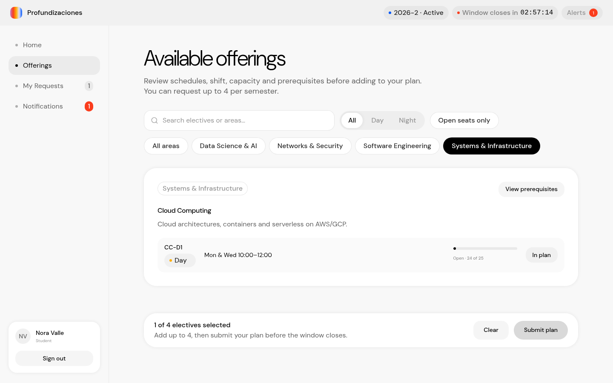
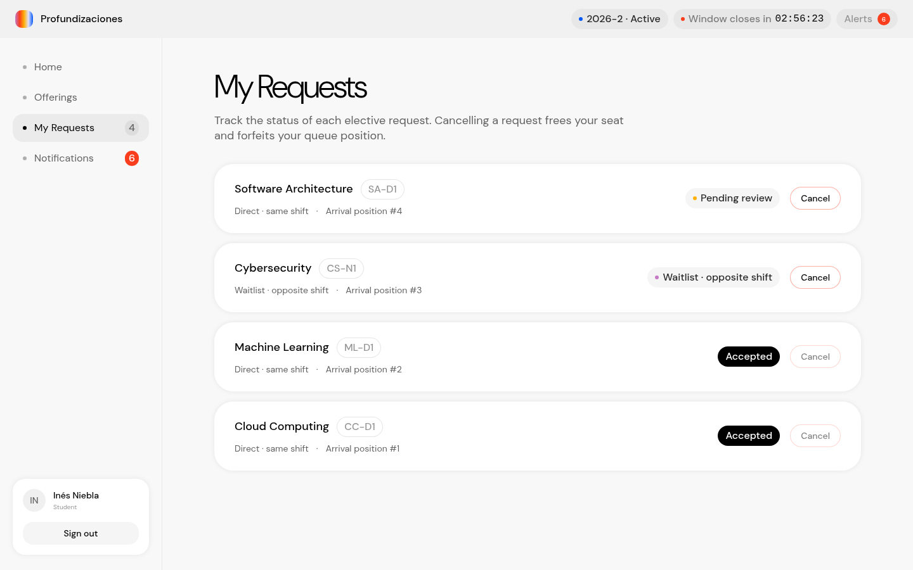
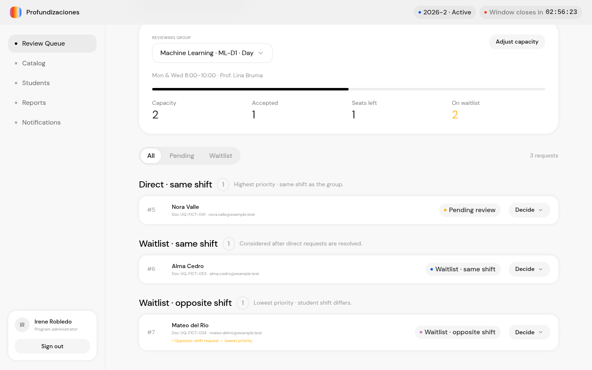
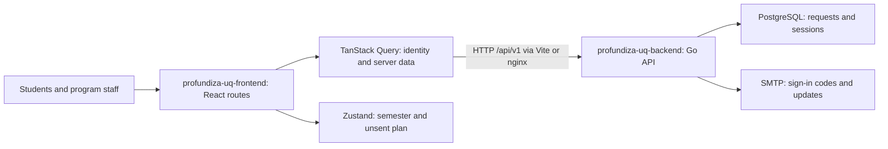

<!-- markdownlint-disable-next-line MD041 -->
<div align="center">

<h1>Profundiza UQ · Web App</h1>

<p><strong>Plan, request, and review professional electives at Universidad del Quindío.</strong></p>

<p>
<a href="https://github.com/diegnghtmr/profundiza-uq-frontend/actions/workflows/ci.yml"></a>


<a href="LICENSE"></a>
</p>

<p>
<a href="https://diegnghtmr.me/en/work/profundiza-uq/"><strong>Case study</strong></a> &bull;
<a href="#quick-start"><strong>Quick start</strong></a> &bull;
<a href="#architecture"><strong>Architecture</strong></a> &bull;
<a href="https://github.com/diegnghtmr/profundiza-uq-backend"><strong>Backend repo</strong></a>
</p>

</div>

<p align="center"></p>

Before an enrollment window closes, students need to compare elective groups and know what happened after they applied. Profundiza UQ lets them assemble a plan, submit their selections, and track each request separately. Staff use the same application to work through group-specific review queues and record decisions.

## Features

- **Email sign-in.** Students and staff verify a one-time code; navigation follows the role returned by the API.
- **Offerings and plan.** Inspect schedules, shifts, prerequisites, and capacity, then submit up to four selections as a batch.
- **Request tracking.** See per-group status and arrival order, cancel eligible requests, and read notifications.
- **Staff review.** View the queue by offering group, inspect its capacity and priority tiers, and record a decision with a reason.
- **Catalog and administration.** Manage electives, groups, prerequisites, capacity, and student records; request report exports and download completed files.
- **Super-administrator settings.** Manage administrative users and global settings from role-protected routes.

## Preview



Submitting a plan does not mean every selection is accepted. My Requests shows the outcome for each group.



Staff work through direct and waitlisted requests for a selected group.

## Quick start

Use Node.js **22** and pnpm **11**, as in CI. Start the [Go API](https://github.com/diegnghtmr/profundiza-uq-backend#quick-start) and its PostgreSQL and SMTP dependencies first. Load the backend's local seed if you need ready-to-use student and staff accounts.

```sh
git clone https://github.com/diegnghtmr/profundiza-uq-frontend.git
cd profundiza-uq-frontend
pnpm install --frozen-lockfile
pnpm dev
```

Open <http://localhost:5173/login>. Enter a local demo email, select **Send code**, then enter the emailed code and select **Verify**. If using Mailpit on its usual local UI port, read the code at <http://localhost:8025>. The UI has no bypass for code verification.

| Variable | Purpose | Default |
| --- | --- | --- |
| `VITE_API_URL` | Browser API base URL; leave unset to use the same-origin proxy. | `/api/v1` |
| `VITE_PROXY_TARGET` | Backend address used by the Vite process for `/api` requests. | `http://localhost:8080` |

`pnpm build` type-checks the app and produces the static bundle. The [Dockerfile](Dockerfile) serves it through nginx; [nginx.conf](nginx.conf) forwards `/api` unchanged to `backend:8080` and falls back to `index.html` for client-side routes. Use that service name in the deployment network, or configure an equivalent same-origin reverse proxy so cookie sessions work without cross-origin requests.

## Architecture

Every runtime screen talks to the real API. The API enforces roles and owns enrollment decisions; `RequireAuth` and `RequireRole` control browser route access from the identity returned by `/me`. Route modules load on demand. Feature-owned queries and components share the API client, role-aware navigation, and UI primitives.



### Conventions

TanStack Query owns server state, including `/me`; Zustand stores selected semester and unsent plan state, not identity. React Hook Form and Zod validate forms with labeled inputs and accessible errors; pending mutations disable resubmission and surface API errors. The Tailwind theme uses DM Sans from Google Fonts, monochrome controls and status badges, and a spectrum gradient for ambient glow and small accents only.

## Tech stack

| Layer | Technology |
| --- | --- |
| Application | React 19, TypeScript 5.9 (lockfile), React Router 7 |
| Data and forms | TanStack Query, Zustand, React Hook Form, Zod |
| Interface | Tailwind CSS 4, Radix UI, DM Sans |
| Build and checks | Vite 6, nginx, ESLint, Vitest, Testing Library |

## Testing

```sh
pnpm lint
pnpm build
pnpm test
```

[CI](.github/workflows/ci.yml) installs with a frozen lockfile and runs all three checks; the production dependency audit is report-only. Vitest covers components, stores, and page smoke flows: badge mappings, the draft's four-selection limit, sign-in, offerings, student requests, and administrative views with data and empty states. Use `pnpm test:watch` for the interactive runner.

## Project structure

```text
src/app/       Shell, lazy routes, and role guards
src/features/ Student, staff, and administrator workflows
src/shared/   API client, queries, UI primitives, and client stores
src/styles/   Tailwind theme and global styles
test/         Shared test setup and smoke tests
```

## Documentation

- [Frontend reference](docs/frontend-reference.md) — SIPP-UQ feature map, route roles, form conventions, and design system.

## Related repositories

- [profundiza-uq-backend](https://github.com/diegnghtmr/profundiza-uq-backend) — enrollment, session identity, group capacity, notifications, and reports.

## License

Released under the [MIT License](LICENSE).
